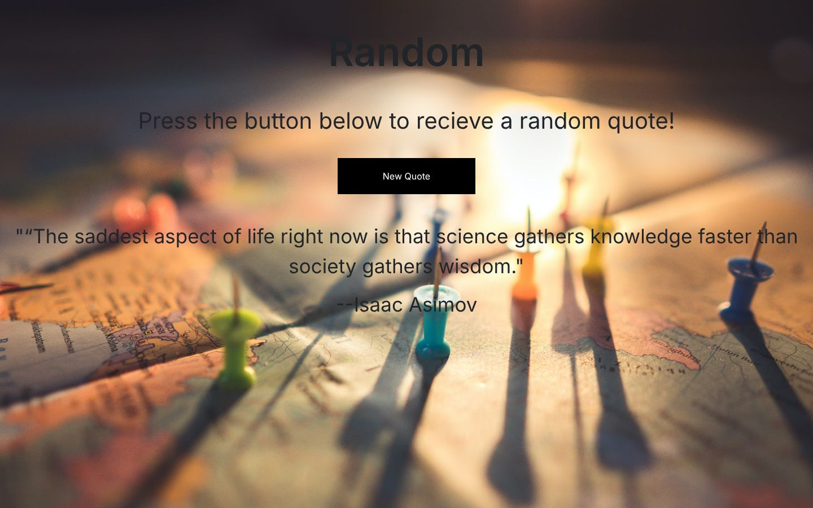

<div align="center">

# Random

### A one-button random quote generator in vanilla JavaScript

A tiny practice page from my 2022 front-end training. Press **New Quote** and it shows a random quote and its author from a small built-in list.

[](https://developer.mozilla.org/docs/Web/HTML)
[](https://developer.mozilla.org/docs/Web/CSS)
[](https://developer.mozilla.org/docs/Web/JavaScript)
<br>
[](https://eslamraafat1.github.io/Random/)

**[Live demo](https://eslamraafat1.github.io/Random/)** ·
**[Portfolio](https://new-portfolio-ashy-xi.vercel.app/)** ·
**[LinkedIn](https://www.linkedin.com/in/eslamraafat-dev/)** ·
**[Email](mailto:eslamraafat736@gmail.com)**

<br>



</div>

<table>
  <tr>
    <td width="40%"></td>
    <td width="60%">
      <b>How it works</b><br>
      Six quote/author pairs live in an array in <code>js/hello.js</code>. The button picks a random index with <code>Math.random()</code> and writes the quote and author into the page with <code>textContent</code>.
    </td>
  </tr>
  <tr>
    <td align="center"><sub>Mobile (iPhone 13)</sub></td>
    <td align="center"><sub>Desktop 1440 × 900 above</sub></td>
  </tr>
</table>

---

## Overview

A **small learning exercise** from my 2022 front-end course, covering arrays of objects, random numbers and DOM updates. It has no dependencies beyond static CSS files.

**Known issue:** the random index is computed with `+ 1`, so roughly one click in seven picks an index past the end of the array and nothing changes (an error appears in the console).

## Tech stack

| Layer | Tools |
| --- | --- |
| Markup and styles | HTML5, CSS3 (Bootstrap 5.2 and Font Awesome 6.1 CSS are linked) |
| Scripting | Vanilla JavaScript |
| Hosting | GitHub Pages |

## Project structure

```text
.
├── index.html            # heading, button, quote output
├── js/hello.js           # quotes array + changeButton()
├── style.css             # layout and background photo
├── bootstrap.min.css · all.css · webfonts/
└── docs/screenshots/     # README images
```

## Getting started

No build step. Open `index.html` in a browser, or serve the folder:

```bash
git clone https://github.com/Eslamraafat1/Random.git
cd Random
npx serve .          # http://localhost:3000
```

## Deployment

Hosted on **GitHub Pages** from the `master` branch: **https://eslamraafat1.github.io/Random/**

## Author

**Eslam Raafat**, Front-End Developer (React · Next.js · TypeScript)

- **Portfolio:** [new-portfolio-ashy-xi.vercel.app](https://new-portfolio-ashy-xi.vercel.app/)
- **LinkedIn:** [linkedin.com/in/eslamraafat-dev](https://www.linkedin.com/in/eslamraafat-dev/)
- **GitHub:** [@Eslamraafat1](https://github.com/Eslamraafat1)
- **Email:** [eslamraafat736@gmail.com](mailto:eslamraafat736@gmail.com)
